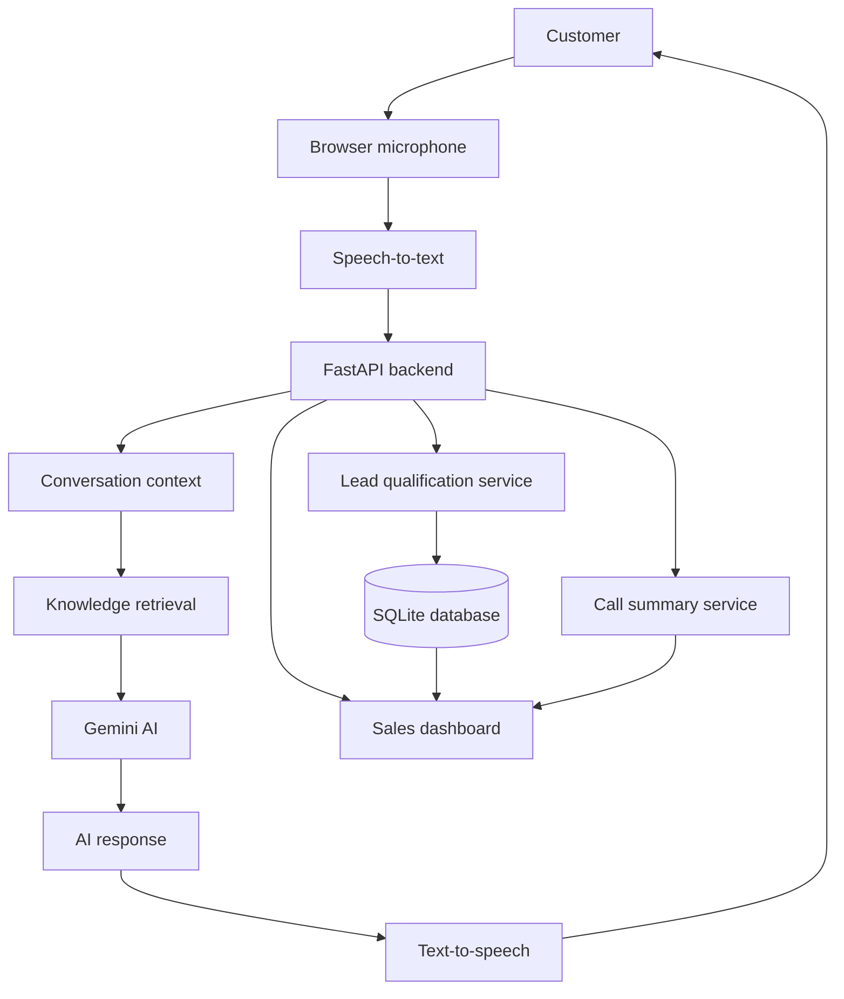

# Architecture

Routiqo AI Sales Agent is a small local system. The browser handles speech recognition and speech output. Python handles product answers, scoring, and storage. One knowledge file is the only product source the assistant may use.

## Request path

Speech-to-text uses `SpeechRecognition` or `webkitSpeechRecognition` in the browser. The UI requests `en-IN` by default, allows `en-US`, and displays interim and final results separately. The complete finalized text is sent to `POST /api/chat` only when listening stops. Browser speech support and service availability vary; Brave is not guaranteed to support it.

If speech recognition is unsupported or fails, the customer can type. The rest of the path is the same.

## What each piece does

**Browser.** Uses Web Speech API, keeps finalized and interim text separately, and sends the complete finalized transcript after listening stops. It holds conversation history for the open tab and sends the last 12 turns with each new message. Session storage keeps the chat if the page is refreshed. Saved leads are not kept only in the browser.

**FastAPI (`app/main.py`).** Serves the page and the JSON API. It checks the body size, validates JSON with Pydantic, and returns a short error if something unexpected fails. It does not put the API key in the response.

**Conversation context.** The API is stateless. Memory is the history array on `POST /api/chat`. The agent keeps at most 12 recent user and assistant turns so the Gemini request stays small. Facts already extracted from that text are listed in the system instruction so the model is less likely to ask again.

**Knowledge retrieval (`app/knowledge_base.py`).** The markdown file is split on `##` headings. The customer message and each section are reduced to words. Overlap is scored. A word in the heading counts more than a word in the body. A few obvious variants are folded together, such as "routes" and "route". The overview section is always included. Matching sections are pasted into the prompt. There is no embedding model and no vector database. If the notes do not cover the question, the assistant says the sales team can explain it in a demonstration.

**Gemini (`app/ai_agent.py`).** The official `google-genai` client calls `models.generate_content`. The model id is `GEMINI_MODEL`. The system instruction sets the sales behaviour: short replies, one question, no invented features, no savings promises, no claim that a meeting is booked. Thinking is set to the smallest level so a short reply is less likely to be cut off.

**Demo mode.** If the key or model is missing, or the API raises, the same function builds a reply from the matched knowledge section and the next missing qualification question. The JSON field `mode` is `demo`. The page says so.

**Lead qualification (`app/lead_service.py`).** Score arithmetic is in Python, not in the model. See the point table in the README. The recommended next action is a sentence for a human salesperson. It does not create a calendar event.

**Call summary.** `POST /api/summarize` asks Gemini for a short JSON summary. The score and next action are overwritten with the Python result so the model cannot change the qualification. If that call fails, a template summary is built from the form fields. Saving the lead still works.

**SQLite (`app/database.py`).** The `leads` table is created on startup. Only an explicit save writes a row. The transcript and the API key are not columns.

**Dashboard.** The same origin as the API. The lead panel, summary panel, and leads table read the JSON the endpoints return.

## Demo request, not a booking

`interested_in_demo` is a boolean on the lead. The dashboard shows "Demo requested" and reminds the operator that no calendar slot was created. A later version could call a scheduling API. This version does not pretend that call already happened.

## Production scalability

The laptop version is one Uvicorn process and one SQLite file. SQLite is a single file with one writer at a time. That fits a demo. It is not a multi-server database.

A production shape, none of which is running in this prototype:

| Piece | Why it would be added |
| --- | --- |
| Load balancer | Spread HTTP traffic across more than one FastAPI process. |
| Multiple backend instances | Survive one process restarting. Each instance must be stateless, which this API already is, because history arrives with the request. |
| PostgreSQL | Many writers, backups, and concurrent sales users. Replace the SQLite file. Keep parameterized queries. |
| Redis | Hold a short-lived conversation if you do not want the browser to send the full history, with a time-to-live so calls are not stored forever. |
| Background workers | Generate summaries and CRM pushes after the HTTP response, so a slow model call does not hold the page. |
| Dedicated voice infrastructure | A telephony provider for real phone numbers, with its own speech-to-text and text-to-speech. The browser API cannot dial a handset. |
| Monitoring | Latency, error rate, and Gemini failures. Logs must keep redacting the API key. |
| Rate limiting | Stop one client from exhausting the Gemini quota. |
| Secure cloud deployment | HTTPS, a secret manager, a private database, and no demo mode on a public URL. |

### Registered users and simultaneous calls

100,000 registered users means 100,000 accounts or leads that exist in a database. Most of them are idle. The database and login system have to store and find them. They do not all talk at once.

100,000 simultaneous voice calls means 100,000 live audio sessions at the same moment. Each one needs a speech stream, a model request, and a worker. That is a telephony and capacity problem, not a row-count problem. This prototype is built for one person at a laptop. It does not support 100,000 concurrent calls, and the code should not be described as if it does.

## What is intentionally simple

- No LangChain, LangGraph, or multi-agent setup. One function builds a prompt and calls the model.
- No login.
- No vector index.
- No telephone gateway.
- No calendar provider.
