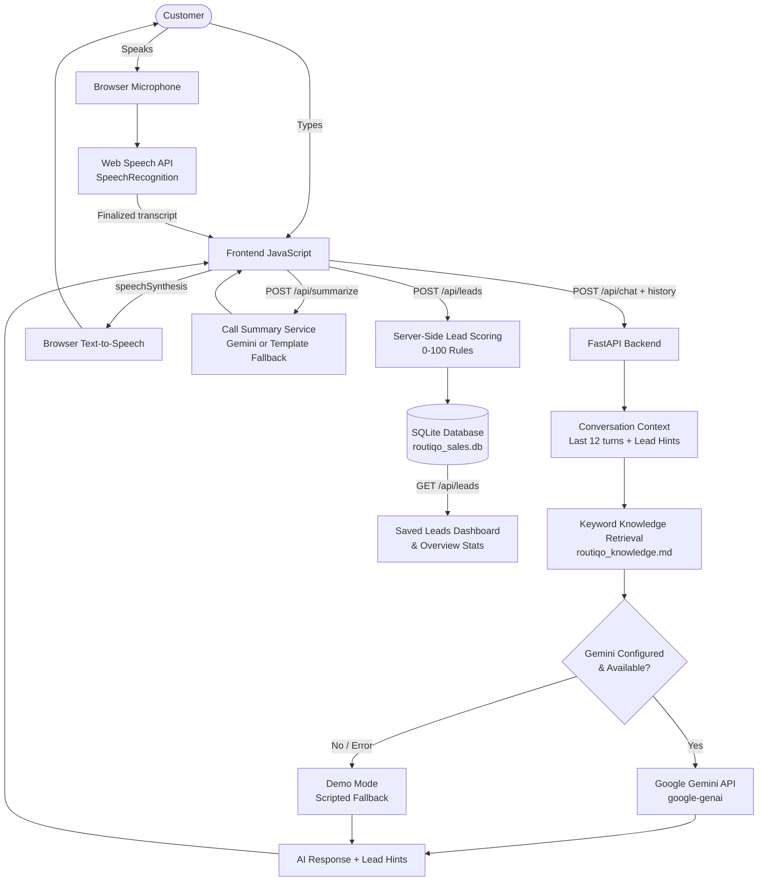

# Routiqo AI Sales Agent


A local voice-enabled AI sales assistant prototype for **Routiqo**, a fleet dispatch and route optimization platform for last-mile logistics businesses.

The application conducts an initial product and qualification conversation in the browser:

**Customer speaks or types → AI responds → lead information is collected → lead is scored → lead is saved → call summary is generated.**

> **Note:** This is a local demonstration prototype. It uses the browser microphone and Web Speech API rather than telephone calling, and it records demonstration interest as a flag rather than booking a calendar appointment.

**Author:** Akshat Gupta

---

## Contents

- [Project Overview](#project-overview)
- [Key Features](#key-features)
- [Technology Stack](#technology-stack)
- [Architecture](#architecture)
- [How the Application Works](#how-the-application-works)
- [Project Structure](#project-structure)
- [Installation and Setup](#installation-and-setup)
- [Environment Variables](#environment-variables)
- [Running the Application](#running-the-application)
- [Demo Instructions](#demo-instructions)
- [Lead Scoring System](#lead-scoring-system)
- [API Documentation](#api-documentation)
- [Database](#database)
- [Testing](#testing)
- [Security and Limitations](#security-and-limitations)
- [Future Improvements](#future-improvements)
- [Author](#author)

---

## Project Overview

Before a sales representative can qualify a logistics prospect, they typically have to explain how dispatch and route optimization work, ask about fleet size, uncover operational bottlenecks, and determine whether a product demonstration makes sense. Handling every initial inquiry manually is repetitive, and unstructured call notes are easy to lose.

**Routiqo AI Sales Agent** automates that first-touch qualification conversation on a single-page sales desk:

- Prospects ask questions about Routiqo by speaking or typing.
- The assistant answers strictly from a local product knowledge file (`knowledge/routiqo_knowledge.md`) and asks one qualification question at a time.
- Key details (name, company, email, fleet size, operational problem, and demo interest) are extracted into a reviewable lead form.
- The backend calculates a transparent rule-based lead score, persists the lead to SQLite, and generates a structured call summary with a recommended next action.

---

## Key Features

### Implemented in This Prototype

- **Voice-Based Conversation:** Uses the browser's `SpeechRecognition` / `webkitSpeechRecognition` API (`en-IN` default, `en-US` selectable) to capture spoken customer input.
- **Text Input Fallback:** Includes a standard message composer for environments where microphone permissions or browser speech recognition are unavailable.
- **Browser Text-to-Speech:** Reads assistant replies and generated call summaries aloud using `window.speechSynthesis`.
- **Gemini-Powered Responses:** Uses the official `google-genai` SDK with a configurable model ID (`GEMINI_MODEL`) and constrained sales system prompt.
- **Labeled Demo Mode Fallback:** Automatically falls back to deterministic, scripted replies when `GEMINI_API_KEY` or `GEMINI_MODEL` is unset or when the Gemini API fails. Replies are explicitly labeled `demo` in the UI and API response.
- **Product Knowledge Retrieval:** Parses `knowledge/routiqo_knowledge.md` by `##` headings and ranks sections using weighted keyword overlap (title matches weighted higher than body matches), always including the product overview.
- **Stateless Conversation Context:** The browser stores the active tab's transcript in `sessionStorage` and sends recent turns (`conversation_history`, up to 20 messages; backend trims to the last 12 turns) on each `POST /api/chat` request.
- **Automatic Lead Hint Extraction:** Regex-based extraction (`extract_lead_hints`) pre-fills the lead form from the conversation transcript; the operator can review or edit any field before saving.
- **Deterministic Server-Side Lead Scoring:** Calculates a 0–100 score, qualification status (`Qualified`, `Potential`, `Not Qualified`), score breakdown, and recommended next action in Python.
- **SQLite Lead Persistence:** Saves qualified/reviewed leads to a local SQLite database (`routiqo_sales.db`) that survives server restarts.
- **Call Summary Generation:** Produces a structured summary (`summary`, `customer_requirements`, `pain_points`, `demo_interest`, `next_action`) via Gemini with a local template fallback.
- **Saved Leads Dashboard & Overview:** Displays saved leads in a refreshable table, lets you inspect individual lead details, tracks `interested_in_demo` requests, and shows aggregate counts in the **Overview** tab.

> See [Future Improvements](#future-improvements) for capabilities that are intentionally out of scope for this prototype (such as authentication, real calendar booking, CRM sync, and telephony).

---

## Technology Stack

| Layer | Technology | Purpose |
| --- | --- | --- |
| **Backend Framework** | Python 3, FastAPI, Uvicorn | Serves the static dashboard and JSON REST API (`app/main.py`) |
| **Validation & Config** | Pydantic v2, `python-dotenv` | Request/response schema validation and `.env` configuration |
| **AI Integration** | Google Gemini (`google-genai` SDK) | Live conversational responses and call summary generation |
| **Knowledge Retrieval** | Python (`re`, `pathlib`) | Heading-based markdown parsing and keyword-overlap retrieval |
| **Frontend UI** | HTML5, CSS3, Vanilla JavaScript | Single-page sales desk, lead form, summary panel, and leads table |
| **Speech I/O** | Browser Web Speech API | `SpeechRecognition` / `webkitSpeechRecognition` for STT and `speechSynthesis` for TTS |
| **Database** | SQLite (`sqlite3`) | Local relational persistence for saved leads |
| **Testing** | `pytest`, `httpx` (FastAPI `TestClient`) | Unit and API integration tests without external Gemini calls |

---

## Architecture

The backend is intentionally stateless for chat: the browser manages the active session transcript and sends recent turns with each request. Product knowledge is retrieved locally via keyword overlap (no vector database or embeddings), and lead scoring is computed exclusively on the server.



For a deeper breakdown of design choices and production scaling considerations, see [ARCHITECTURE.md](ARCHITECTURE.md).

---

## How the Application Works

1. **Start a Conversation:** Open the dashboard at `http://127.0.0.1:8000`. The frontend checks `/api/health` to display whether the server is in **Demo mode** or connected to a configured Gemini model.
2. **Speak or Type:** The customer clicks the microphone button (or **Start Listening**) to speak, or types directly into the message box.
3. **Speech-to-Text Conversion:** If using voice, the browser's Web Speech API captures interim speech separately from finalized text. When listening stops, the finalized transcript is submitted.
4. **Send Message to Backend:** The browser appends the message to its session history and sends a `POST /api/chat` request containing `conversation_id`, `message`, and `conversation_history` (up to 20 recent turns).
5. **Retrieve Product Knowledge:** `app/knowledge_base.py` tokenizes the customer's message, folds simple word variants (e.g., `routes` → `route`, `cost` → `pricing`), and scores sections of `knowledge/routiqo_knowledge.md` by keyword overlap. The overview section and top matching sections are included in the prompt.
6. **Generate Response:** `app/ai_agent.py` extracts any lead hints from the conversation, injects them into the system prompt so the assistant avoids repeating answered questions, and calls Gemini (or falls back to `build_demo_reply` in demo mode).
7. **Speak Response:** The frontend displays the assistant's reply in the transcript and reads it aloud using `window.speechSynthesis`.
8. **Collect Lead Information:** Returned `lead_hints` automatically pre-fill empty fields in the **Lead details** form (`customer_name`, `company_name`, `email`, `vehicle_count`, `business_problem`, `interested_in_demo`). The operator can edit any field manually.
9. **Generate Call Summary:** When **Save lead and summarize** is clicked, the frontend first calls `POST /api/summarize` with the conversation transcript and form fields to generate a structured summary (via Gemini or local fallback).
10. **Score the Lead:** The frontend then calls `POST /api/leads`. The backend runs `score_lead()` in `app/lead_service.py` to compute the score, qualification status, score breakdown, and recommended next action—ignoring any client-supplied score.
11. **Persist & Display:** `app/database.py` inserts the lead into SQLite and returns the saved record, which is rendered in the **Saved leads** table and reflected in the **Overview** tab.

---

## Project Structure

```text
routiqo-ai-sales-agent/
├── app/
│   ├── __init__.py
│   ├── ai_agent.py          # Gemini integration, system prompt, demo mode, call summarization
│   ├── config.py            # Environment variable loading and Settings dataclass
│   ├── database.py          # SQLite schema initialization, parameterized CRUD queries
│   ├── knowledge_base.py    # Markdown section parser and keyword-overlap retrieval
│   ├── lead_service.py      # Deterministic lead scoring, regex hint extraction, fallback summary
│   ├── main.py              # FastAPI app, middleware, exception handler, API routes
│   └── schemas.py           # Pydantic request/response models and field validators
├── knowledge/
│   └── routiqo_knowledge.md # Single source of truth for Routiqo product facts
├── static/
│   ├── assets/
│   │   └── logo.svg         # Routiqo vector logo
│   ├── index.html           # Single-page sales desk UI (Chat Mode & Overview)
│   ├── overview.js          # Overview stats, recent leads list, and sample script helpers
│   ├── script.js            # Web Speech API (STT/TTS), chat state, lead form, API calls
│   └── style.css            # Application styling
├── tests/
│   ├── conftest.py          # Pytest fixtures and isolated temporary SQLite DB setup
│   ├── test_api.py          # FastAPI TestClient endpoint and knowledge retrieval tests
│   ├── test_database.py     # SQLite persistence and parameterized query tests
│   └── test_lead_service.py # Lead scoring, thresholds, and regex hint extraction tests
├── .env.example             # Safe template for environment variables
├── .gitignore               # Ignores .venv, .env, __pycache__, and *.db files
├── ARCHITECTURE.md          # Detailed system design and production scaling notes
├── PRESENTATION_GUIDE.md    # Project walkthrough and interview talking points
├── PROJECT_REPORT.md        # Concise project summary report
├── pytest.ini               # Pytest configuration (pythonpath = .)
├── requirements.txt         # Python dependencies
└── run.sh                   # Linux/macOS startup script
```

---

## Installation and Setup

### Prerequisites

- **Python 3.10+** (tested on Python 3.12)
- A modern Chromium-based browser (e.g., Google Chrome) if testing browser speech recognition; text input works in any modern browser.

### 1. Clone the Repository

```bash
git clone <YOUR_GITHUB_REPOSITORY_URL>
cd routiqo-ai-sales-agent
```

### 2. Create and Activate a Virtual Environment

**Linux / macOS:**

```bash
python3 -m venv .venv
source .venv/bin/activate
```

**Windows (PowerShell):**

```powershell
python -m venv .venv
.venv\Scripts\Activate.ps1
```

### 3. Install Dependencies

```bash
pip install -r requirements.txt
```

### 4. Configure Environment Variables

**Linux / macOS:**

```bash
cp .env.example .env
```

**Windows (PowerShell):**

```powershell
Copy-Item .env.example .env
```

If you want live Gemini responses, add your Google AI Studio API key to `.env`. To run in **demo mode** without an API key, leave `GEMINI_API_KEY=` empty.

---

## Environment Variables

Configuration is loaded from `.env` via `app/config.py`.

| Variable | Description | Default / Example |
| --- | --- | --- |
| `GEMINI_API_KEY` | Google AI Studio API key. Optional—if empty or placeholder, the app runs in demo mode. | `""` (empty) |
| `GEMINI_MODEL` | Gemini model identifier passed to `google-genai`. Not hard-coded in app logic so it can be updated easily. | `gemini-3.5-flash-lite` |
| `DATABASE_PATH` | Path to the SQLite database file. Relative paths resolve from the project root. | `./routiqo_sales.db` |

### Safe `.env.example` Reference

```dotenv
# Copy this file to .env and fill in your own key.
# Never commit .env. The application reads these names at startup.

# API key from Google AI Studio. Leave the placeholder to run in demo mode.
GEMINI_API_KEY=

# Model id from Google AI Studio. Change this if Google retires the model.
# This name is not hard-coded in the application; only this setting is read.
GEMINI_MODEL=gemini-3.5-flash-lite

# SQLite file. A relative path is stored inside this project folder.
DATABASE_PATH=./routiqo_sales.db
```

> **Security:** Never commit `.env` or expose your `GEMINI_API_KEY` in client-side code or logs. `app/config.py` redacts the key from `__repr__` and error logs.

---

## Running the Application

### Option 1: Using the Startup Script (Linux / macOS)

```bash
./run.sh
```

`run.sh` activates `.venv` if present, verifies that required Python packages are installed, and starts Uvicorn on `127.0.0.1:8000`.

### Option 2: Manual Start (Linux / macOS / Windows)

With your virtual environment activated:

```bash
uvicorn app.main:app --reload --host 127.0.0.1 --port 8000
```

### Verifying the Server

Once running, open:

- **Sales Dashboard:** [http://127.0.0.1:8000](http://127.0.0.1:8000)
- **Interactive API Docs (Swagger UI):** [http://127.0.0.1:8000/docs](http://127.0.0.1:8000/docs)
- **Health Check:** [http://127.0.0.1:8000/api/health](http://127.0.0.1:8000/api/health)

A healthy response from `/api/health` returns HTTP `200` with `"status": "ok"` and `"database": "ok"`.

---

## Demo Instructions

1. **Open the Dashboard:** Navigate to [http://127.0.0.1:8000](http://127.0.0.1:8000).
2. **Check Status Chips:** Verify the top bar shows a connected status and either **Demo mode** (local scripted replies) or your configured **Gemini model**.
3. **Start a Conversation:** Click the microphone orb (or **Start Listening**) and allow microphone access, or type into the message input box.
4. **Run the Sample Fleet Conversation** *(fictional sample data)*:
   - *"Hi, I am Priya Shah from Northline Logistics."*
   - *"We have 35 vehicles."*
   - *"We struggle with manual route planning and late deliveries."*
   - *"My email is priya@northline.example and yes, I would like a product demo."*
   - *"How does Routiqo optimize routes?"*
5. **Review Lead Details:** Watch the **Lead details** form auto-fill as details are detected. Correct or add any fields if needed.
6. **Save and Summarize:** Click **Save lead and summarize**.
   - Expected score: **100**
   - Expected status: **Qualified**
   - Expected demo interest: **Demo requested** *(note: this flags interest only and does not book a calendar slot)*
   - Expected next action: **Schedule a product demonstration with the sales team.**
7. **Inspect Saved Leads:** View the new row in the **Saved leads** table and check the **Overview** tab for updated counts. Refreshing the page or restarting the server preserves saved leads in SQLite.
8. **Reset Chat:** Click **New conversation** to clear the browser transcript without deleting saved leads.

---

## Lead Scoring System

Lead qualification is implemented deterministically in `app/lead_service.py` (`score_lead`). The score is always computed on the backend from the submitted lead fields—the frontend and LLM cannot set or override it.

### Scoring Signals

| Signal | Condition | Points |
| --- | --- | --- |
| **Fleet Size** | `vehicle_count >= 10` | 30 |
| **Operational Problem** | `business_problem` is non-empty and not a negative phrase (e.g., `"none"`, `"no problem"`, `"n/a"`) | 30 |
| **Demo Interest** | `interested_in_demo` is `true` | 25 |
| **Contact Information** | Valid email address provided | 15 |
| **Maximum Possible Score** | | **100** |

### Qualification Thresholds & Next Actions

| Score Range | Qualification Status | Recommended Next Action |
| --- | --- | --- |
| **70 – 100** | `Qualified` | *"Schedule a product demonstration with the sales team."* (if demo requested) or *"Contact the customer and invite them to a product demonstration."* |
| **40 – 69** | `Potential` | *"Confirm the demonstration request and collect any missing qualification details."* (if demo requested) or *"Send a follow-up with Routiqo information and ask if they want a demonstration."* |
| **0 – 39** | `Not Qualified` | *"Thank the customer and keep the lead for a later follow-up. No immediate demo."* |

---

## API Documentation

All JSON endpoints enforce a maximum request body size of **100 KB** (`MAX_BODY_BYTES = 100_000`) and validate payloads using Pydantic models in `app/schemas.py`.

| Method | Endpoint | Description |
| --- | --- | --- |
| `GET` | `/` | Serves the single-page sales dashboard (`static/index.html`) |
| `GET` | `/api/health` | Returns database health, AI/demo mode status, and model name (never exposes API key) |
| `POST` | `/api/chat` | Generates an AI or demo reply using knowledge retrieval and recent conversation history |
| `POST` | `/api/leads` | Scores a lead on the server, generates a fallback summary if omitted, and saves to SQLite |
| `GET` | `/api/leads` | Lists all saved leads ordered newest-first |
| `GET` | `/api/leads/{lead_id}` | Fetches a single saved lead by ID (`404` if not found) |
| `POST` | `/api/summarize` | Generates a structured call summary via Gemini or local template fallback |

### Endpoint Examples

#### `GET /api/health`

```json
{
  "status": "ok",
  "demo_mode": true,
  "model": "gemini-3.5-flash-lite",
  "database": "ok",
  "config_issue": "GEMINI_API_KEY is not set. The app is running in demo mode."
}
```

#### `POST /api/chat`

Request:
```json
{
  "conversation_id": "a1b2c3d4",
  "message": "We have 35 vehicles and struggle with manual route planning.",
  "conversation_history": [
    { "role": "user", "content": "Hi, I am Priya Shah from Northline Logistics." },
    { "role": "assistant", "content": "Hello! How many vehicles are in your fleet?" }
  ]
}
```

Response:
```json
{
  "conversation_id": "a1b2c3d4",
  "response": "Noted, a fleet of 35 vehicles. That operational challenge is useful context. If you are comfortable sharing it, what email should the team use for follow-up?",
  "mode": "demo",
  "knowledge_sections": [],
  "lead_hints": {
    "customer_name": "Priya Shah",
    "company_name": "Northline Logistics",
    "email": null,
    "vehicle_count": 35,
    "business_problem": "We have 35 vehicles and struggle with manual route planning.",
    "interested_in_demo": null
  },
  "notice": null
}
```

#### `POST /api/leads`

Request:
```json
{
  "customer_name": "Priya Shah",
  "company_name": "Northline Logistics",
  "email": "priya@northline.example",
  "vehicle_count": 35,
  "business_problem": "Manual route planning and late deliveries",
  "interested_in_demo": true,
  "call_summary": null
}
```

Response:
```json
{
  "id": 1,
  "customer_name": "Priya Shah",
  "company_name": "Northline Logistics",
  "email": "priya@northline.example",
  "vehicle_count": 35,
  "business_problem": "Manual route planning and late deliveries",
  "interested_in_demo": true,
  "lead_score": 100,
  "qualification_status": "Qualified",
  "call_summary": "Priya Shah from Northline Logistics spoke with the Routiqo sales assistant. Fleet size: 35 vehicles. Pain point: Manual route planning and late deliveries. Demo interest: Demo requested. Lead score: 100 (Qualified). Recommended next action: Schedule a product demonstration with the sales team.",
  "next_action": "Schedule a product demonstration with the sales team.",
  "recommended_next_action": "Schedule a product demonstration with the sales team.",
  "score_breakdown": {
    "vehicle_count": 30,
    "business_problem": 30,
    "demo_interest": 25,
    "contact_information": 15
  },
  "created_at": "2026-11-26T00:00:00+00:00"
}
```

#### `POST /api/summarize`

Request:
```json
{
  "transcript": "Customer: We have 35 vehicles and want a demo.",
  "customer_name": "Priya Shah",
  "company_name": "Northline Logistics",
  "email": "priya@northline.example",
  "vehicle_count": 35,
  "business_problem": "Manual route planning",
  "interested_in_demo": true
}
```

Response:
```json
{
  "summary": "Priya Shah from Northline Logistics spoke with the Routiqo sales assistant...",
  "customer_requirements": "Manual route planning",
  "pain_points": "Manual route planning",
  "demo_interest": "Demo requested",
  "next_action": "Schedule a product demonstration with the sales team.",
  "mode": "fallback",
  "lead_score": 100,
  "qualification_status": "Qualified",
  "score_breakdown": {
    "vehicle_count": 30,
    "business_problem": 30,
    "demo_interest": 25,
    "contact_information": 15
  }
}
```

---

## Database

The application uses Python's built-in `sqlite3` module (`app/database.py`) to persist leads in `routiqo_sales.db` (configurable via `DATABASE_PATH`).

- **Why SQLite:** Zero-configuration, single-file persistence suitable for a local demonstration prototype.
- **Stored Schema (`leads` table):** `id`, `customer_name`, `company_name`, `email`, `vehicle_count`, `business_problem`, `interested_in_demo`, `lead_score`, `qualification_status`, `call_summary`, `next_action`, and `created_at` (UTC ISO timestamp).
- **What Is Not Stored:** Full conversation transcripts and the `GEMINI_API_KEY` are **not** stored in SQLite. Only leads explicitly saved by the user are written.
- **SQL Safety:** All queries use `?` parameterized placeholders to prevent SQL injection.

---

## Testing

The project uses `pytest` (configured via `pytest.ini`) and FastAPI's `TestClient`. Tests run offline against temporary SQLite databases and do not call the Gemini API.

Run the test suite from the `routiqo-ai-sales-agent` directory:

```bash
pytest -v
```

### What the Tests Cover

- `tests/test_api.py` — Health endpoint, static dashboard serving, multi-turn demo chat memory, empty message rejection (`422`), unknown product question guardrails, server-side lead scoring, persistence across app restarts, `404` handling, validation errors, fallback summarization, and keyword knowledge retrieval.
- `tests/test_database.py` — Database initialization, `ping()`, lead insert/list/get, persistence after closing connections, and parameterized query safety.
- `tests/test_lead_service.py` — Scoring rules, vehicle count threshold (`>= 10`), negative/empty problem handling, email contact points, classification boundaries (`Qualified`, `Potential`, `Not Qualified`), and regex lead hint extraction.

All 23 tests pass (`23 passed in 0.46s`) when run in the project virtual environment.

---

## Security and Limitations

- **No Authentication:** There is no login, session auth, or role-based access control. This application is intended for local demonstration only.
- **Browser Speech Compatibility:** `SpeechRecognition` / `webkitSpeechRecognition` depends on browser support, microphone permissions, and browser-provided speech services (support varies across browsers such as Brave vs. Chrome).
- **Gemini Dependency for Live AI:** Live conversational responses and AI-written summaries require a valid `GEMINI_API_KEY` and network access; otherwise, the app operates in demo/fallback mode.
- **No Real Telephony or Calendar Booking:** The app does not dial phone numbers and does not integrate with a calendar API.
- **Single-Writer SQLite:** SQLite is appropriate for local single-user demos, not concurrent multi-user production workloads.
- **API Key Hygiene:** Keep `.env` private and never commit real API keys.

---

## Future Improvements

Possible next steps to evolve this prototype toward a production system:

- **Authentication & Authorization:** Add user login and role-based access control before hosting on a shared network.
- **Real Calendar Scheduling:** Integrate a scheduling API (e.g., Google Calendar or Calendly) when a prospect requests a demo.
- **CRM Integration:** Export qualified leads and call summaries directly to an external CRM.
- **Telephony Integration:** Connect a SIP/CPaaS provider for real inbound/outbound voice calls instead of browser-only audio.
- **Enhanced Knowledge Retrieval:** Replace keyword overlap with semantic/hybrid retrieval if the product knowledge base grows significantly.
- **Scalable Infrastructure:** Migrate from SQLite to PostgreSQL, store short-lived call state in Redis, and offload summary/CRM jobs to background workers behind a load balancer with HTTPS, rate limiting, and monitoring.

---

## Author

**Akshat Gupta**
